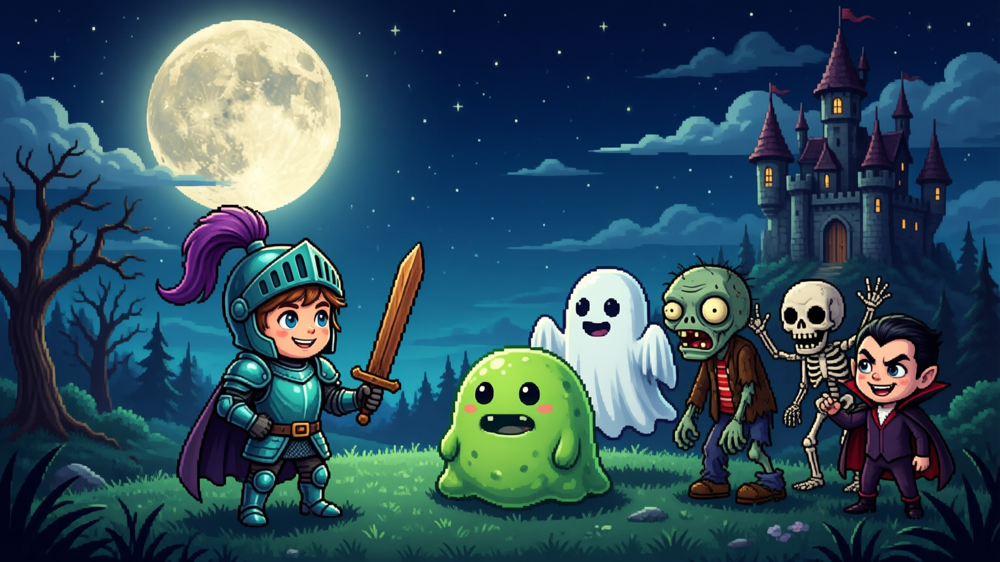

# Boo Knight

A little spooky-**cute** knight game made for a 6-year-old, playable in a web browser.

Think of the classic side-scrolling platform games, but friendly instead of scary: a kid
knight in teal armour runs, jumps and swings a sword through three levels of silly monsters
— wobbly slimes, surprised little ghosts, a goofy zombie, a grinning skeleton, a small
vampire boy — and finally meets the Vampire Lord. The monsters are cartoonish, there is no
gore and nothing jump-out-and-terrify-you; the art was made for a six-year-old.



## Playing it

**Online:** <https://bryn1.github.io/boo-knight/> — this is the official play link, and it
ships with the v1.0.0 release. (If the link does not open yet, the release push is still
running; the home-network options below work now.)

**On your home network**, if the game is being served from a computer in the house:

| device | open this |
|---|---|
| the computer running the game | `http://localhost:8791/` |
| a laptop / tablet on the same network | `https://192.168.5.231:8792/` |

The home-network address uses the household server's own certificate, so the browser will
show a "your connection is not private" warning the first time: choose *Advanced* →
*Continue* (this is normal for a home server and nothing to worry about).

**Your own copy:** the browser only starts this kind of game from `https://` or
`localhost` — plain `http://192.168.x.x` is refused by the browser itself, not by the game.
So to run the built game for your kid, serve it and open it as `localhost` (see *Building it
yourself* below).

A keyboard is needed — the arrow keys and two letter keys; there are no touch controls.

## Controls

| what | keys |
|---|---|
| walk left / right | **← →** (or A and D) |
| jump | **Space** (or ↑ / W) |
| swing the sword | **X** (or J) |

On the title screen, press **Space** to begin.

## The rules, in plain words

- You start with a **wooden sword**.
- Deeper into each level there is a **treasure chest** with a better sword: **stone**, then
  **iron**, then **diamond**. Each one makes the sword hit harder, so monsters go down in
  fewer swings. Walking over a weaker sword changes nothing — you never lose an upgrade.
- You have **30 hearts** of health, shown in the top row as 15 hearts (each worth 2).
- **Apples and bread** lie around the levels: an apple patches you up a little, bread a lot,
  never past full.
- The monsters are tougher in different ways — a slime is easy, a skeleton takes several
  hits, and the Vampire Lord takes many. This is what the better swords are for.
- **Three levels**, and at the end of the third one the **Vampire Lord** is waiting.
- If you run out of hearts, the whole adventure starts again from level 1 with the wooden
  sword and full hearts. This is on purpose: it is how the old arcade games worked, it keeps
  the rule easy to understand, and it was the design the game was asked for.
- Every level gives you a few safe seconds as soon as you appear, so a monster can't hit you
  the instant you spawn.

## For grown-ups: the age note

This game was designed **for** a 6-year-old, not merely allowed for one. The monsters are
goofy rather than frightening, there is no blood or gore, and the only "hard" part is losing
and starting over. Expect the restart rule to cause a little frustration — that was a
deliberate choice, and it is the one conversation-starter this game is good at.

## Made with

[Godot 4](https://godotengine.org/) 4.7 (GDScript), exported for the browser. Every piece of
pixel art — all 19 sprites plus 16 animation frames — was generated **locally on an RTX 3090
in the family's home workshop**; no cloud art services. Built by the family's AI workshop.

## Building it yourself

You need [Godot 4.7.2](https://godotengine.org/download/archive/) with its **Web export
templates** installed, and Python 3 to serve the result. Point `GODOT` at your Godot binary:

```sh
GODOT=/path/to/Godot_v4.7.2-stable_linux.x86_64

# link the art folder into the project and import the PNGs
tools/sync_assets.sh

# the rules gate: 24 assertions, must print "SIM PASS"
"$GODOT" --headless --path godot -s res://tests/sim.gd

# prove that gate can actually fail (planted-bad run, prints "SIM FAIL", exit 1)
"$GODOT" --headless --path godot -s res://tests/sim.gd -- --plant-bad

# boot all three levels + the boss headless, must print "SMOKE OK"
"$GODOT" --headless --path godot res://tests/smoke.tscn

# build the browser version
"$GODOT" --headless --path godot --export-release "Web" build/web/index.html

# play it: any static file server over build/web, opened as localhost
python3 -m http.server 8080 -d build/web
# then open http://localhost:8080/
# (on the machine that also runs the home server, ports 8791 and 8792 are taken by it)
```

`build/` is build output and is not kept in the repository — you make it with the export
command above. The same commands are the ones the build passes recorded in
[`LEDGER.md`](LEDGER.md); the rules live in `godot/src/rules.gd` and the sprite list in
[`docs/SPRITES.md`](docs/SPRITES.md).

---

Made at home, for one six-year-old, by the family's own build workshop.
